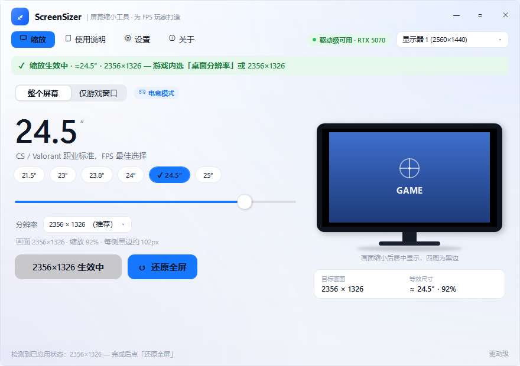

# ScreenSizer

把大屏缩成小屏，为 FPS 玩家带来更熟悉的职业手感。

很多 FPS 玩家的显示器是 27 英寸甚至更大，但职业赛场上最常见的是 **24.5 英寸**（CS / Valorant 职业选手的标准尺寸，如 Zowie XL2546）。大屏的问题是：画面超出中心视野，眼球需要大幅移动才能看到边缘信息。

ScreenSizer 通过**驱动级居中缩放**，把你大屏的显示区域物理缩小成小屏大小——画面居中显示，四周留黑边，无需买新显示器。



## 功能

- **驱动级缩放（NVIDIA）**：通过 NVAPI 创建自定义分辨率 + 居中无缩放模式，游戏/桌面均生效，低延迟、无输入延迟
- **窗口模式兜底**：非 NVIDIA 显卡时，可将任意游戏窗口居中缩放到目标大小
- **按英寸选**：预设 21.5 / 23 / 23.8 / 24 / **24.5（★ 电竞标准）** / 25 英寸
- **按分辨率选**：适合 4K→2K 这类场景，自动列出目标分辨率并标注等效尺寸
- **一键还原**：恢复原生分辨率 + 原始缩放模式 + 清理自定义模式
- **应急还原**：状态丢失/应用崩溃后也能强制恢复原生设置
- **外部修改检测**：游戏改了分辨率会自动检测并提示
- **状态横幅**：应用后一眼可见「缩放生效中 · 2356×1326」

## 技术栈

- C# / WPF，.NET 8（`net8.0-windows`）
- NVAPI（动态加载 `nvapi64.dll`，无需 SDK）
- Win32 `ChangeDisplaySettingsEx` / `EnumDisplaySettingsEx`
- 自绘 UI，不依赖系统主题/透明效果设置

## 构建

```bash
dotnet build ScreenSizer.slnx -c Release
```

输出在 `ScreenSizer/bin/Release/net8.0-windows/`。

也可以发布单文件 exe（无需安装 .NET 运行时）：

```bash
dotnet publish ScreenSizer/ScreenSizer.csproj -c Release -r win-x64 --self-contained
```

## 使用

1. 打开软件，选择「整个屏幕」模式
2. 拖动滑块选尺寸（推荐 24.5″，职业标准）或按分辨率选
3. 点「应用」——屏幕会闪烁一下，画面居中缩小
4. 启动游戏，选「全屏 + 桌面分辨率」即可
5. 玩完点「还原全屏」恢复

## 注意

- 需要 NVIDIA 显卡才能用驱动级缩放（NVAPI）
- 窗口模式适用于所有显卡
- 自定义分辨率会在驱动层面清理，不会残留

## 目录结构

```
ScreenSizer.slnx
├── ScreenSizer/          # WPF 主程序
│   ├── Native/           # NVAPI / Win32 / DWM 封装
│   ├── Services/         # 缩放逻辑、状态持久化、显示器枚举
│   ├── Models/           # 数据模型
│   └── Themes/           # 自定义 UI 样式
└── Probe/                # NVAPI 诊断工具
```

## 作者

[智宇丶817](https://space.bilibili.com/41173761)
