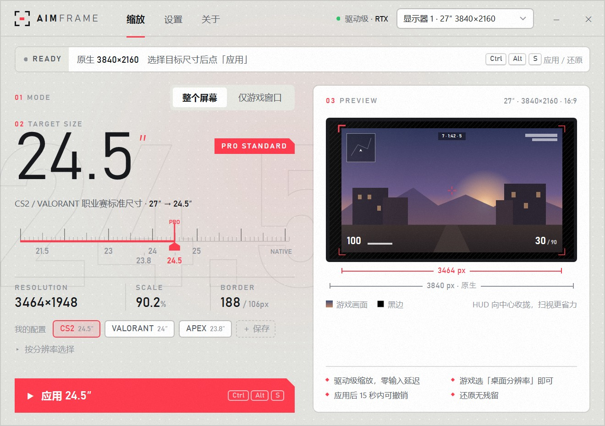
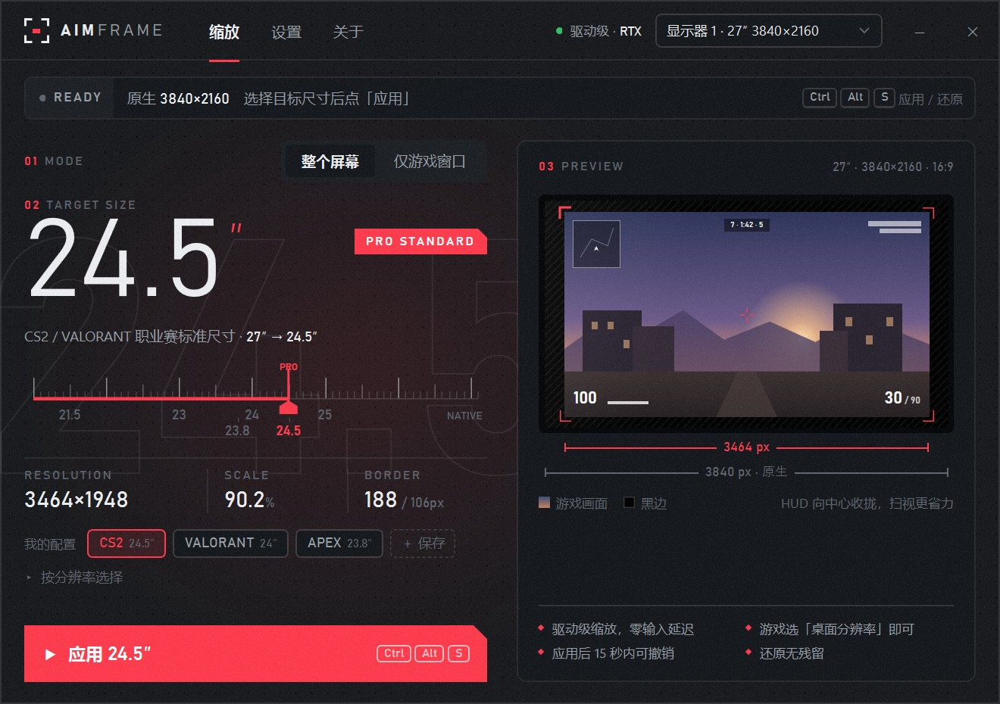
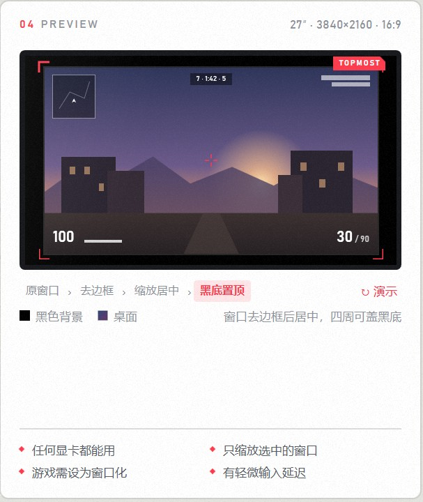
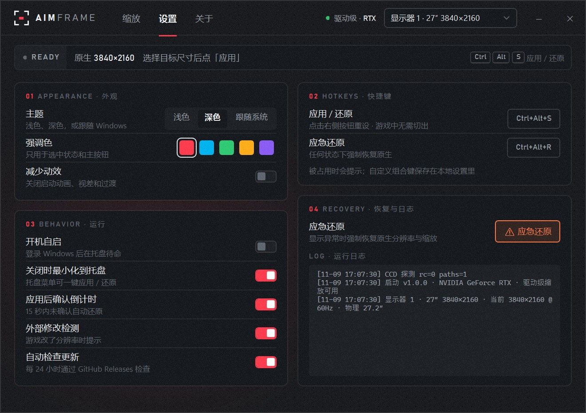

# AimFrame 准框



**把 27 寸、32 寸的大屏在显卡层面缩成 24.5 寸大小，画面居中显示，四周留黑边。给想在大屏上找回比赛屏手感的 FPS 玩家用。**

## 1 为什么做这个

现在很多玩家的显示器是 27 寸甚至更大，而 CS2、瓦罗兰特职业比赛的标准屏幕是 24.5 寸，比如 Zowie XL2546。

屏幕大了，小地图、血量、弹药、击杀信息都离屏幕中心更远。看一眼这些信息，眼睛要多走一段路，回到准星也要多花一点时间。平时感觉不明显，对枪的时候就会体现出来。

最直接的办法是再买一块 24.5 寸的屏。不想多买一块的话，NVIDIA 控制面板里的「调整桌面尺寸和位置」可以手动做到同样的效果，但每次都要建自定义分辨率、改缩放模式，玩完还要再改回去。步骤多，改错了还容易黑屏。

AimFrame 把这套操作做成了一个按钮。选好尺寸点应用，玩完点还原。

## 2 缩多少

缩小是按对角线比例算的。以 24.5 寸为目标，几块常见屏幕的结果如下：

| 原屏幕 | 原生分辨率 | 缩小后的画面 | 画面占比 | 每侧黑边（左右 / 上下） |
|---|---|---|---|---|
| 27″ 2K | 2560×1440 | 2356×1326 | 92% | 102 / 57 px |
| 27″ 4K | 3840×2160 | 3464×1948 | 90.2% | 188 / 106 px |

实际数值取决于显示器上报的物理尺寸，同样标称 27 寸的屏，结果可能差几个像素。

画面整体等比缩小，游戏里的 HUD 会一起往中心收。下图右侧的预览里，深色外框是原屏幕，红色角标框住的是缩小后的画面。



## 3 三种缩法

不同显卡能做到的程度不一样，软件会按显卡自动选。

| 方式 | 适用显卡 | 怎么实现 | 尺寸精度 | 输入延迟 |
|---|---|---|---|---|
| 驱动级 | NVIDIA | NVAPI 创建自定义分辨率，缩放模式设为「居中无缩放」 | 任意尺寸，精确到 0.1″ | 不增加 |
| 系统缩放 | AMD / Intel | Windows 显示配置接口设为居中缩放，分辨率只能用驱动已有的档位 | 吸附到最近的可用分辨率 | 不增加 |
| 仅游戏窗口 | 所有显卡 | 把游戏窗口去边框、缩小、居中，可选黑色背景和置顶 | 任意尺寸 | 有轻微延迟 |

前两种对桌面和所有全屏游戏都生效。第三种只动你选中的那个窗口，游戏要设成窗口化或无边框窗口。



## 4 用法

1. 打开软件，选「整个屏幕」。
2. 在刻度尺上拖到想要的尺寸，或者直接点 24.5。常用的尺寸可以存到「我的配置」里。
3. 点「应用」。屏幕会闪一下，然后弹出一个 15 秒的确认框，画面正常就点「保留此设置」。
4. 打开游戏，显示模式选全屏，分辨率选「桌面分辨率」。
5. 玩完点「还原全屏」，或者在游戏里直接按 Ctrl+Alt+S。

如果 15 秒内没有点保留，软件会自动改回原来的分辨率。这是为了应对应用后黑屏、看不到窗口的情况。

## 5 防止改坏

改分辨率这件事出错的代价比较大，所以留了几层退路：

| 情况 | 处理 |
|---|---|
| 应用后黑屏或显示异常 | 15 秒不确认，自动还原 |
| 应用失败 | 当场回滚到原分辨率和原缩放模式 |
| 软件崩溃、状态丢失 | 「应急还原」不依赖保存的状态，直接回到原生设置，快捷键 Ctrl+Alt+R |
| 游戏自己改了分辨率 | 检测到后在状态栏提示，可以一键还原 |

应用前的原始分辨率和缩放模式会写进本地文件，还原时按记录恢复，自定义分辨率也会一并删掉。

## 6 其他功能

- **全局热键**：默认 Ctrl+Alt+S 应用或还原，Ctrl+Alt+R 应急还原。被别的软件占用时设置页会提示，可以改成别的组合。
- **托盘**：关掉窗口后留在托盘，右键就能应用或还原。
- **外观**：浅色、深色、跟随系统三种主题，5 种强调色。嫌动画多可以打开「减少动效」。
- **自动检查更新**：每 24 小时查一次 GitHub Releases，有新版本时「关于」旁边会出现红点。



## 7 下载与构建

在 [Releases](https://github.com/ZYY817/ScreenSizer/releases/latest) 下载 `AimFrame.exe`，双击就能运行，不用安装 .NET。支持 Windows 10 / 11（64 位）。

第一次运行时 Windows 可能弹出「已保护你的电脑」，这是因为程序没有数字签名，点「更多信息」再点「仍要运行」即可。

想自己编译的话，需要 .NET 8 SDK：

```bash
dotnet build ScreenSizer/ScreenSizer.csproj -c Release
```

编译出来的程序在 `ScreenSizer/bin/Release/net8.0-windows/AimFrame.exe`。

想打包成一个不用装 .NET 运行时的单文件：

```bash
dotnet publish ScreenSizer/ScreenSizer.csproj -c Release -r win-x64 --self-contained -p:PublishSingleFile=true
```

设置、缩放状态和日志存在 `%LOCALAPPDATA%\AimFrame`。从旧版本升级时，旧数据会自动复制过来。

## 8 局限

1. 系统缩放只能用显卡驱动已有的分辨率。有的 Intel 核显在 2560×1440 和 3840×2160 之间没有中间档位，27 寸 4K 屏选 24.5 寸时会被吸附到 2560×1440，也就是约 18 寸。这种情况建议用窗口模式。
2. 驱动级缩放只支持 NVIDIA。AMD 的驱动也能建自定义分辨率，但还没有接入。
3. 系统缩放在 AMD 显卡上还没有实测过，如果遇到问题欢迎提 Issue，附上「设置 › 日志」里的内容。
4. 窗口模式会给游戏加一层窗口管理，输入延迟比全屏略高，对延迟敏感的话优先用前两种方式。
5. 屏幕尺寸来自显示器上报的物理尺寸。少数显示器上报不准或不上报，这时等效尺寸会有偏差，可以改用「按分辨率选择」。

## 9 目录结构

```
ScreenSizer/          WPF 主程序，输出 AimFrame.exe
  Controls/           刻度尺、字距文字、描边文字、补间动画
  Native/             NVAPI、Windows 显示配置、Win32 接口封装
  Services/           三种缩放方式、状态保存、主题、热键、托盘、更新检查
  Themes/             浅色 / 深色配色和控件样式
Probe/                显示接口诊断工具
docs/images/          截图
```

## 作者

[智宇丶817](https://space.bilibili.com/41173761)

有问题或者建议，可以在 [Issues](https://github.com/ZYY817/ScreenSizer/issues) 里提。
